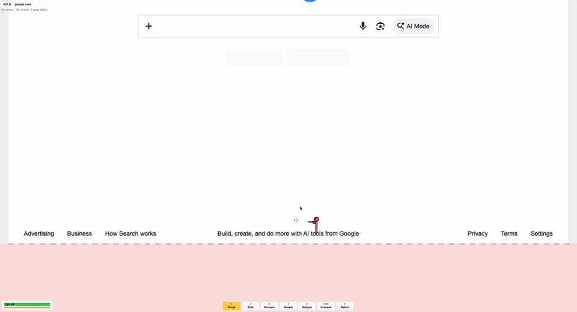
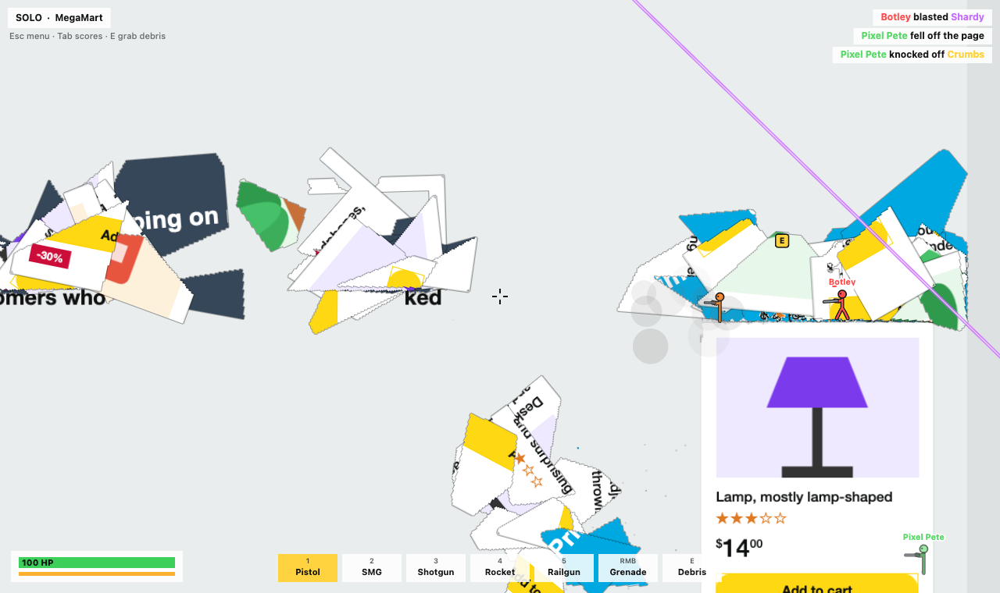
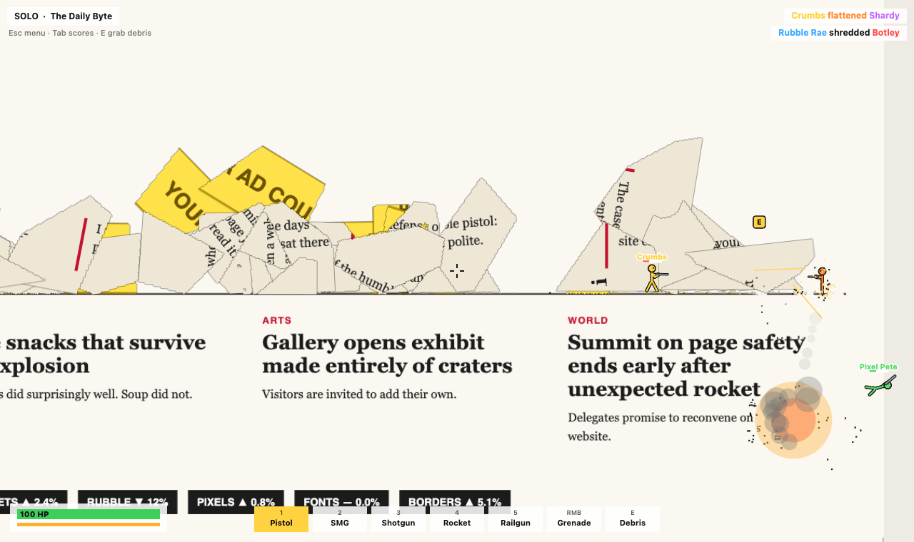
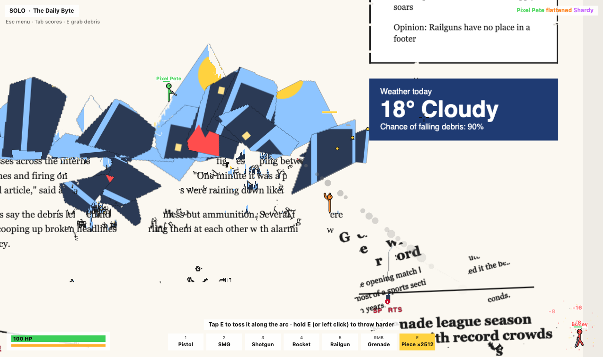
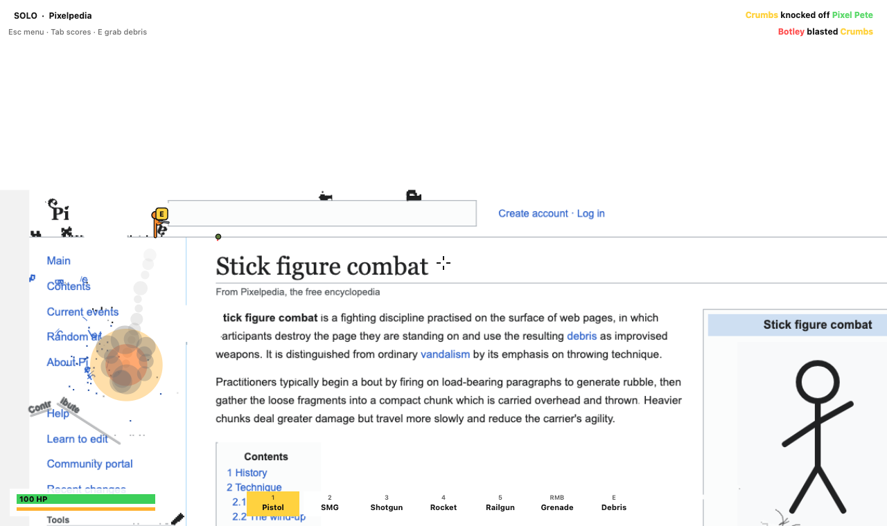
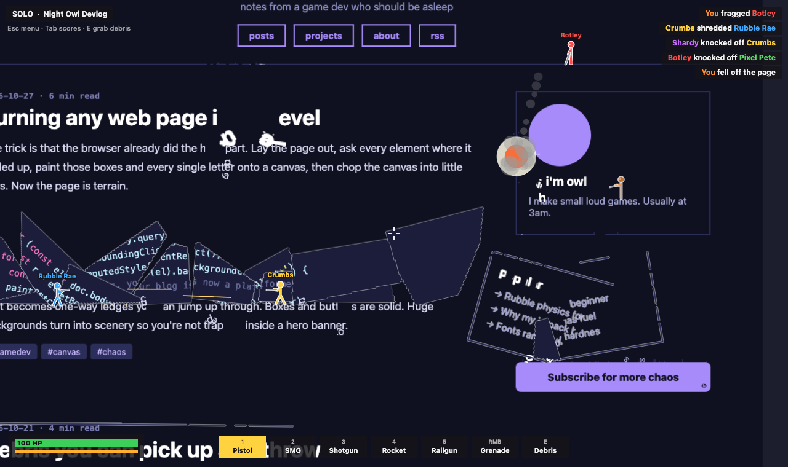
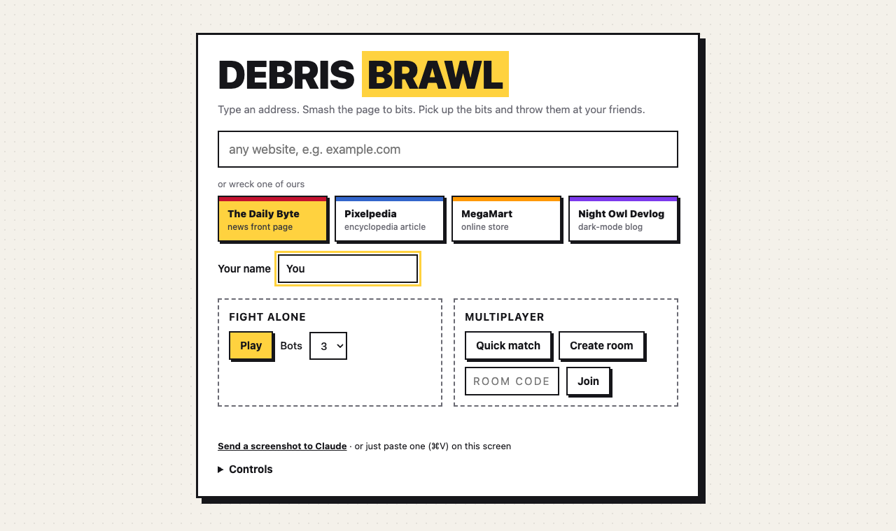

# Debris Brawl

Type an address. Smash the page to bits. Pick up the bits and throw them at your friends.

A take on Destroy Any Website where the wreckage is a weapon: any web page becomes pixel terrain you run,
jump and fly across while you shoot it apart, and everything you blow up becomes **rubble you can pick up
and throw**. A thrown chunk of page hurts whoever it lands on.

Inspired by [Destroy Any Website](https://www.spritefusion.com/games/destroy-any-website) by Hugo Duprez
on [Sprite Fusion](https://www.spritefusion.com/). Unofficial and not affiliated.





| | |
| --- | --- |
|  |  |
|  |  |



## Run it

```sh
npm install
npm start            # http://localhost:8787
```

Open it, pick one of the four built-in pages (or type any address), and press **Play** for solo with bots,
**Create room** to get a 6-character code / invite link for friends, or **Quick match**.

Tick **Debris only** for a match with no guns or grenades: E (or a click) tears a piece off the page where
you aim, a letter whole or anything else as a rock, and that's what you throw. A room keeps the mode its
creator picked; quick match only pairs you with rooms of the mode you ticked.

The server listens on all interfaces (`HOST=0.0.0.0`) so friends on your network can join via your IP.
Use `HOST=127.0.0.1 npm start` to keep it local, `PORT=…` to change the port.

## Controls

| Key | Action |
| --- | --- |
| A / D, ← / → | Run |
| Space / W | Jump, tap again to flip, hold to fly (jetpack fuel refills on the ground) |
| S | Drop through text, hold to keep falling through |
| Mouse, left click | Aim, shoot |
| Right click / G | Grenade |
| 1–5, wheel | Pistol, SMG, Shotgun, Rocket, Railgun |
| **E** | **Pick up a loose letter, shard or rubble (or catch one in mid-air)** |
| **E again** | **Throw it: tap to toss along the arc, hold E (or left click) to wind up harder. Bigger pieces hit harder but fly slower** |
| Tab · Esc · M | Scores · menu (change page, add bots, invite) · sound |

## How it works

- **Page → terrain** (`public/js/raster.js`): the page is laid out in a sandboxed iframe with scripts off,
  every box, border, picture and letter is painted onto canvases, and those are cut into 2 px cells.
  Letters are one-way ledges, boxes and pictures are solid, huge backgrounds become scenery.
- **One match, two homes** (`shared/game.js`): the same authoritative simulation runs on the server for
  rooms and in the browser for solo. It owns bullets, rockets, grenades, debris, damage, bots and the
  5-minute rounds. Your own stickman moves locally (`shared/physics.js`) so controls feel instant.
- **Identical pages everywhere** (`shared/debris.js`): every terrain change goes out as a small op
  (carve a circle with this seed, bake these cells into rubble…). The server applies its own ops through
  the same function clients use, so every copy of the page matches cell for cell.
- **The page stays itself**: it's drawn from a full-resolution picture of the real page, so text stays
  crisp. A bullet knocks a whole letter loose; boxes (backgrounds, borders, pictures) take damage and,
  once worn down, crack into a few rigid shards that keep their pixels and whatever text was on them.
  Loose letters and shards tumble, bounce, and when they lie still they settle back into the page as
  rubble in their own shape.
- **Debris**: the middle of an explosion turns to sand: particles land and settle as rubble. E picks up
  a loose letter or shard in reach (or catches one mid-air), otherwise scoops up to 110 cells of rubble
  into a rock carried overhead. Thrown pieces damage on contact (`8 + 0.42 × cells`, scaled by speed),
  crater the page if they hit it hard, and burst back into rubble.

## Fetching other sites safely

`/api/page` and `/api/asset` fetch third-party pages and pictures for the rasterizer. They:

- allow only http/https on ports 80/443, no credentials in URLs;
- resolve DNS once, refuse any private, loopback, link-local, CGNAT, multicast or special address
  (IPv4 and IPv6, including mapped/NAT64/6to4 forms) and connect to that exact checked address;
- re-check every redirect hop, cap size (3 MB pages, 4 MB images, counted after decompression) and time;
- strip scripts, frames and refresh tags from pages, and return them as JSON, never as HTML on our origin;
- serve images with `Content-Security-Policy: sandbox` and `nosniff` (SVG is allowed only because of that);
- are rate-limited per IP.

Pages that build their content with JavaScript (listings, product grids) are first opened in a headless
Chrome on the server (`server/render.js`) so their scripts can fill them in; the result is snapshotted as
plain HTML with the scripts stripped. That Chrome is locked down: every request it makes is answered by the
same guarded fetcher (public addresses only), Chrome itself points at a dead proxy so nothing gets out
another way, WebSockets/service workers/WebRTC are off, its sandbox is on, and each render has a deadline
and a byte budget. Without Chrome (or with `RENDER=off`), pages load without their scripts.

## Tests

```sh
npm test         # simulation, sync, SSRF guards, performance (node:test)
npm run e2e      # real server + headless Chrome: two players in a room, debris thrown and landing, solo, a real site
```

`npm run e2e` needs Chrome (or `CHROME=/path/to/chrome`) and `playwright-core`; set `E2E_URL=off` to skip
the step that fetches a real website. Screenshots land in `test/out/`.

## Not done yet

- Touch controls (keyboard and mouse only).
- Accounts, skins, boss fights and the other extras of the original.
